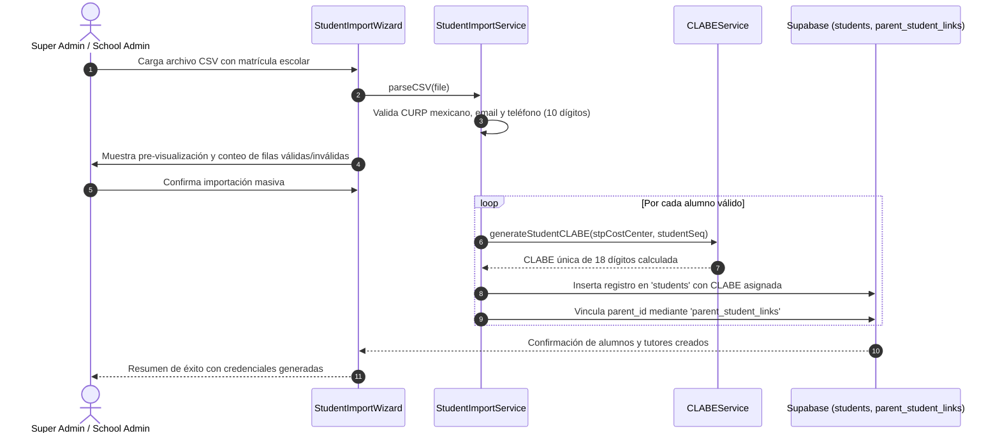
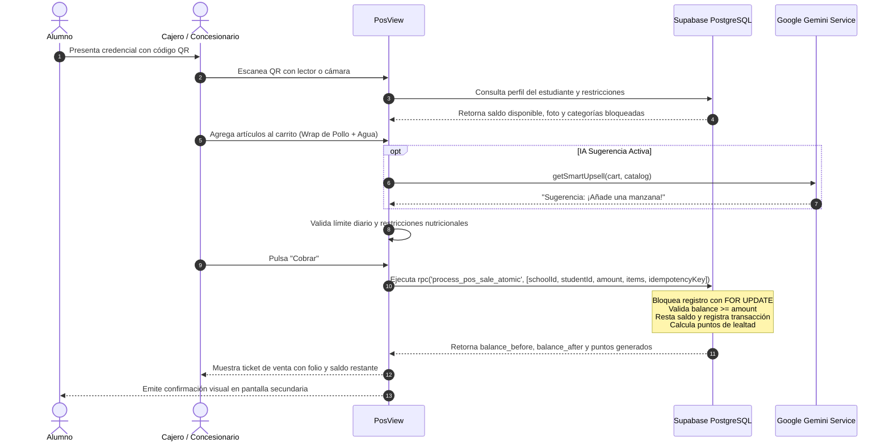
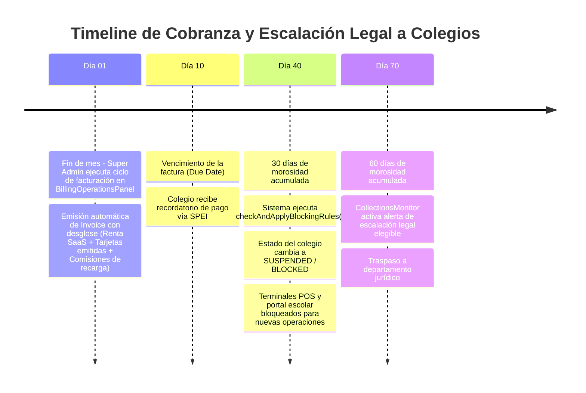

# 02. Mapa Funcional Completo de MeCard

> **Fuentes de Evidencia:** [src/routes/index.tsx](file:///c:/Users/Usuario1/FRCB/Mecard-main-clean/src/routes/index.tsx), [Sidebar.tsx](file:///c:/Users/Usuario1/FRCB/Mecard-main-clean/src/components/Sidebar.tsx), [PLATFORM_READINESS.md](file:///c:/Users/Usuario1/FRCB/Mecard-main-clean/PLATFORM_READINESS.md), [TESTING_ROLES.md](file:///c:/Users/Usuario1/FRCB/Mecard-main-clean/TESTING_ROLES.md) y componentes en `src/components/`.

---

## 1. Inventario Global de Roles y Permisos (RBAC)

La plataforma implementa un modelo de Control de Acceso Basado en Roles (**RBAC**) gestionado por [RoleService.ts](file:///c:/Users/Usuario1/FRCB/Mecard-main-clean/src/services/RoleService.ts) y respaldado por la tabla `user_roles`:

```
┌────────────────────────────────────────────────────────────────────────┐
│                          ROLES EN LA PLATAFORMA                        │
├─────────────────┬──────────────────┬─────────────────┬─────────────────┤
│    CORPORATIVO  │    ESCOLAR       │   CONCESIONES   │    FAMILIAR     │
├─────────────────┼──────────────────┼─────────────────┼─────────────────┤
│ SUPER_ADMIN     │ SCHOOL_ADMIN     │ UNIT_MANAGER    │ PARENT          │
│                 │ SCHOOL_FINANCE   │ POS_OPERATOR    │ STUDENT         │
│                 │                  │ CASHIER         │                 │
│                 │                  │ CAFETERIA_STAFF │                 │
│                 │                  │ STATIONERY_STAFF│                 │
└─────────────────┴──────────────────┴─────────────────┴─────────────────┘
```

---

## 2. Catálogo Completo de Rutas por Rol (53 Rutas Implementadas)

### A. Rutas Públicas y de Autenticación (2 rutas)
| Ruta | Componente Eager | Descripción y Comportamiento |
|---|---|---|
| `/login` | [LoginView.tsx](file:///c:/Users/Usuario1/FRCB/Mecard-main-clean/src/components/LoginView.tsx) | Pantalla de acceso modular con 4 gateways: Corporativo, Colegios, Padres y Alumnos. |
| `/unauthorized` | [Unauthorized.tsx](file:///c:/Users/Usuario1/FRCB/Mecard-main-clean/pages/Unauthorized.tsx) | Mensaje de restricción de permisos 403 con botón de retorno seguro al dashboard del rol. |

### B. Módulo Super Administrador — `SUPER_ADMIN` (16 rutas)
| Ruta | Componente Lazy | Función de Negocio |
|---|---|---|
| `/admin` | [SuperAdminDashboard.tsx](file:///c:/Users/Usuario1/FRCB/Mecard-main-clean/src/components/SuperAdminDashboard.tsx) | KPIs globales: volumen total de dinero, colegios activos, alertas y atajos directos. |
| `/admin/schools` | [SchoolManagement.tsx](file:///c:/Users/Usuario1/FRCB/Mecard-main-clean/src/components/SchoolManagement.tsx) | CRUD de colegios, sedes (*campuses*) y asignación de directores. |
| `/admin/settlement` | [SettlementsView.tsx](file:///c:/Users/Usuario1/FRCB/Mecard-main-clean/src/components/SettlementsView.tsx) | Conciliación y liquidación periódica a cuentas bancarias de escuelas y concesionarios. |
| `/admin/reports` | [ReportsView.tsx](file:///c:/Users/Usuario1/FRCB/Mecard-main-clean/src/components/ReportsView.tsx) | Reportes analíticos de consumo consolidado y tendencias de la red. |
| `/admin/config` | [BusinessModelConfiguration.tsx](file:///c:/Users/Usuario1/FRCB/Mecard-main-clean/src/components/BusinessModelConfiguration.tsx) | Configuración de comisiones MeCard, margen de concesionarios y costos de credenciales. |
| `/admin/billing/config` | [BillingConfigView.tsx](file:///c:/Users/Usuario1/FRCB/Mecard-main-clean/src/components/SuperAdmin/BillingConfigView.tsx) | Ajuste fino de fechas de corte, días de gracia antes de bloqueo y reglas de recargo. |
| `/admin/billing/operations` | [BillingOperationsPanel.tsx](file:///c:/Users/Usuario1/FRCB/Mecard-main-clean/src/components/SuperAdmin/BillingOperationsPanel.tsx) | Ejecución manual o programada del ciclo mensual de emisión de facturas a colegios. |
| `/admin/billing/analytics` | [MecardAnalyticsDashboard.tsx](file:///c:/Users/Usuario1/FRCB/Mecard-main-clean/src/components/SuperAdmin/MecardAnalyticsDashboard.tsx) | Desglose de ingresos MeCard por categoría: rentas SaaS, comisiones tarjeta, comisiones SPEI y float. |
| `/admin/billing/blocking` | [SchoolBlockingManagement.tsx](file:///c:/Users/Usuario1/FRCB/Mecard-main-clean/src/components/SuperAdmin/SchoolBlockingManagement.tsx) | Panel de auditoría de colegios morosos: suspensión automática de servicios y reactivación. |
| `/admin/onboarding` | Redirect → `/admin/schools` | Redirección de compatibilidad al asistente de alta de instituciones. |
| `/admin/schools-directory`| [Schools.tsx](file:///c:/Users/Usuario1/FRCB/Mecard-main-clean/src/_phase2/Schools.tsx) | Directorio visual enriquecido de escuelas activas (conectado a `_phase2`). |
| `/admin/rewards-config` | [AdminRewardsConfig.tsx](file:///c:/Users/Usuario1/FRCB/Mecard-main-clean/src/components/AdminRewardsConfig.tsx) | Parámetros del programa de lealtad: tasa de puntos por peso, multiplicadores y tiers. |
| `/admin/refunds` | [RefundPolicyAdminPage.tsx](file:///c:/Users/Usuario1/FRCB/Mecard-main-clean/src/components/refunds/RefundPolicyAdminPage.tsx) | Supervisión y aprobación en lote de devoluciones y conversiones de saldos no reclamados. |
| `/admin/support` | [SupportSystem.tsx](file:///c:/Users/Usuario1/FRCB/Mecard-main-clean/src/components/SupportSystem.tsx) | Mesa de ayuda interna para tickets de soporte operativo y técnico de colegios. |
| `/admin/sales/simulator` | [CommercialSimulator.tsx](file:///c:/Users/Usuario1/FRCB/Mecard-main-clean/src/components/SuperAdmin/CommercialSimulator.tsx) | Simulador financiero interactivo de ingresos proyectados por modelo (Renta, SaaS, Comisión). |
| `/admin/billing/collections`| [CollectionsMonitor.tsx](file:///c:/Users/Usuario1/FRCB/Mecard-main-clean/src/components/SuperAdmin/CollectionsMonitor.tsx) | Monitor de salud de cartera y seguimiento del timeline legal de cobranza a colegios. |

### C. Módulo Administrador Escolar — `SCHOOL_ADMIN` & `SCHOOL_FINANCE` (14 rutas)
| Ruta | Componente Lazy | Función de Negocio |
|---|---|---|
| `/school` | [SchoolAdminContainer.tsx](file:///c:/Users/Usuario1/FRCB/Mecard-main-clean/src/components/SchoolAdminContainer.tsx) | Tablero operativo escolar: matrícula activa, saldo global, permisos del día y accesos. |
| `/school/students` | [StudentManagementView.tsx](file:///c:/Users/Usuario1/FRCB/Mecard-main-clean/src/components/StudentManagementView.tsx) | Directorio de alumnos por grado y grupo, consulta de saldo, CURP y vinculación familiar. |
| `/school/staff` | [SmartStaffManager.tsx](file:///c:/Users/Usuario1/FRCB/Mecard-main-clean/src/components/SmartStaffManager.tsx) | Asignación de colaboradores a roles específicos (finanzas, prefectura, cajeros). |
| `/school/import` | [StudentImportWizard.tsx](file:///c:/Users/Usuario1/FRCB/Mecard-main-clean/src/components/StudentImportWizard.tsx) | Asistente de 4 pasos para importación de nómina de alumnos mediante CSV, validando CURP. |
| `/school/settings` | [SchoolSettingsView.tsx](file:///c:/Users/Usuario1/FRCB/Mecard-main-clean/src/components/SchoolSettingsView.tsx) | Configuración institucional: logotipo, datos fiscales RFC, ciclos escolares y sedes. |
| `/school/roles` | [CustomRolesManager.tsx](file:///c:/Users/Usuario1/FRCB/Mecard-main-clean/src/components/CustomRolesManager.tsx) | Creación de roles personalizados con permisos granulares (ej. Prefecto, Enfermería). |
| `/school/permissions` | [SchoolPermissionsView.tsx](file:///c:/Users/Usuario1/FRCB/Mecard-main-clean/src/components/SchoolPermissionsView.tsx) | Bandeja de revisión y aprobación de solicitudes de salida anticipada o cambio de ruta. |
| `/school/trips` | [SchoolTripsView.tsx](file:///c:/Users/Usuario1/FRCB/Mecard-main-clean/src/components/SchoolTripsView.tsx) | Creación de excursiones, cupos, planes de pago fraccionados y lista de alumnos confirmados. |
| `/school/refunds` | [SchoolRefundSettingsPage.tsx](file:///c:/Users/Usuario1/FRCB/Mecard-main-clean/src/components/refunds/SchoolRefundSettingsPage.tsx) | Ajuste de políticas locales de devolución en cafetería y canjes de puntos. |
| `/school/invoices` | [SchoolInvoiceDashboard.tsx](file:///c:/Users/Usuario1/FRCB/Mecard-main-clean/src/components/SchoolInvoiceDashboard.tsx) | Consulta de facturas emitidas por MeCard al colegio por renta SaaS o comisiones y botón de pago. |
| `/school/fees` | [SchoolFeesManager.tsx](file:///c:/Users/Usuario1/FRCB/Mecard-main-clean/src/components/SchoolFeesManager.tsx) | Módulo completo de colegiaturas, becas, descuentos, recargos y aging de cobranza. |
| `/school/announcements` | [SchoolAnnouncementsView.tsx](file:///c:/Users/Usuario1/FRCB/Mecard-main-clean/src/components/SchoolAnnouncementsView.tsx) | Publicación de circulares oficiales y avisos urgentes con recepción confirmada a padres. |
| `/school/reports` | [SchoolReportsView.tsx](file:///c:/Users/Usuario1/FRCB/Mecard-main-clean/src/components/SchoolReportsView.tsx) | Reportes de morosidad, flujo de efectivo y asistencia estudiantil. |
| `/school/access` | [SchoolAccessDashboard.tsx](file:///c:/Users/Usuario1/FRCB/Mecard-main-clean/src/components/SchoolAccessDashboard.tsx) | Monitor en tiempo real de torniquetes de entrada/salida y asistencia automática. |
| `/school/collections` | [SchoolCollectionsDashboard.tsx](file:///c:/Users/Usuario1/FRCB/Mecard-main-clean/src/components/SchoolCollectionsDashboard.tsx) | Tablero financiero de cobranza escolar con gráficos de efectividad de recaudo mensual. |

### D. Módulo Concesionario de Unidad — `UNIT_MANAGER` (4 rutas)
| Ruta | Componente Lazy | Función de Negocio |
|---|---|---|
| `/unit` | [ConcessionaireDashboard.tsx](file:///c:/Users/Usuario1/FRCB/Mecard-main-clean/src/components/ConcessionaireDashboard.tsx) | Ventas del día, ticket promedio, horas pico y estado del corte de caja actual. |
| `/unit/inventory` | [InventoryManagementView.tsx](file:///c:/Users/Usuario1/FRCB/Mecard-main-clean/src/components/InventoryManagementView.tsx) | Catálogo de productos, control de existencias, alerta de stock mínimo y precios. |
| `/unit/staff` | [SmartStaffManager.tsx](file:///c:/Users/Usuario1/FRCB/Mecard-main-clean/src/components/SmartStaffManager.tsx) | Gestión de cajeros y despachadores autorizados en la unidad. |
| `/unit/demand` | [CafeteriaDemandForecast.tsx](file:///c:/Users/Usuario1/FRCB/Mecard-main-clean/src/components/CafeteriaDemandForecast.tsx) | Pronóstico predictivo de porciones a cocinar basado en días festivos y ventas previas. |

### E. Módulo Operador de Punto de Venta — `POS_OPERATOR` / `CASHIER` (4 rutas)
| Ruta | Componente Lazy | Función de Negocio |
|---|---|---|
| `/pos` | [PosView.tsx](file:///c:/Users/Usuario1/FRCB/Mecard-main-clean/src/components/PosView.tsx) (cafetería) | Interfaz táctil de cobro rápido con escaneo QR, venta sugerida IA y validación de saldo. |
| `/pos/stationery` | [PosView.tsx](file:///c:/Users/Usuario1/FRCB/Mecard-main-clean/src/components/PosView.tsx) (papelería) | POS adaptado para papelería/librería (cuadernos, lápices, uniformes). |
| `/pos/preorders` | [PreOrderQueueView.tsx](file:///c:/Users/Usuario1/FRCB/Mecard-main-clean/src/components/PreOrderQueueView.tsx) | Cola de comandas de pedidos anticipados organizados por franja horaria de entrega. |
| `/cashier` | [CashierView.tsx](file:///c:/Users/Usuario1/FRCB/Mecard-main-clean/src/components/CashierView.tsx) | Registro y arqueo de efectivo en caja, entrada/salida de dinero y corte X/Z. |

### F. Módulo Portal Familiar — `PARENT` (11 rutas)
| Ruta | Componente Lazy | Función de Negocio |
|---|---|---|
| `/parent` | [ParentPortalContainer.tsx](file:///c:/Users/Usuario1/FRCB/Mecard-main-clean/src/components/ParentPortalContainer.tsx) | Tablero familiar: resumen de todos los hijos, saldos individuales y consumos del día. |
| `/parent/wallet` | [ParentWalletView.tsx](file:///c:/Users/Usuario1/FRCB/Mecard-main-clean/src/components/ParentWalletView.tsx) | Recarga de fondos vía tarjeta de crédito/débito o SPEI, con cálculo transparente de comisiones. |
| `/parent/limits` | [ParentLimitsView.tsx](file:///c:/Users/Usuario1/FRCB/Mecard-main-clean/src/components/ParentLimitsView.tsx) | Configuración de topes de consumo diario ($50-$500) y bloqueo de categorías de productos. |
| `/parent/reports` | [ParentReportsView.tsx](file:///c:/Users/Usuario1/FRCB/Mecard-main-clean/src/components/ParentReportsView.tsx) | Estado de cuenta detallado de compras con gráficos de calorías y categorías. |
| `/parent/notifications` | [ParentNotificationsView.tsx](file:///c:/Users/Usuario1/FRCB/Mecard-main-clean/src/components/ParentNotificationsView.tsx) | Preferencias de alertas push, email y WhatsApp ante consumos o ingresos al colegio. |
| `/parent/permissions` | [ParentPermissionsView.tsx](file:///c:/Users/Usuario1/FRCB/Mecard-main-clean/src/components/ParentPermissionsView.tsx) | Solicitud de permisos de salida (persona autorizada, camión destino, motivo) y aviso de inasistencia. |
| `/parent/gifts` | [ParentGiftsView.tsx](file:///c:/Users/Usuario1/FRCB/Mecard-main-clean/src/components/ParentGiftsView.tsx) | Supervisión y autorización de regalos sociales recibidos o enviados por los hijos. |
| `/parent/fees` | [ParentFeesView.tsx](file:///c:/Users/Usuario1/FRCB/Mecard-main-clean/src/components/ParentFeesView.tsx) | Consulta de colegiaturas pendientes, historial de pagos escolares y descarga de recibos. |
| `/parent/rewards` | [ParentRewardsView.tsx](file:///c:/Users/Usuario1/FRCB/Mecard-main-clean/src/components/ParentRewardsView.tsx) | Visibilidad de puntos de lealtad acumulados por la familia y aprobación de canjes. |
| `/parent/trips` | [ParentTripsView.tsx](file:///c:/Users/Usuario1/FRCB/Mecard-main-clean/src/components/ParentTripsView.tsx) | Inscripción de hijos a excursiones escolares, firma digital de responsiva y pago en parcialidades. |
| `/parent/settings` | [ParentSettingsView.tsx](file:///c:/Users/Usuario1/FRCB/Mecard-main-clean/src/components/ParentSettingsView.tsx) | Perfil familiar, vinculación con co-padre (código 6 dígitos) y bitácora de seguridad. |
| `/parent/birthday` | [BirthdayGifts.tsx](file:///c:/Users/Usuario1/FRCB/Mecard-main-clean/src/components/BirthdayGifts.tsx) | Aportación voluntaria a "vaquitas" de cumpleaños de compañeros de salón. |

### G. Módulo Portal Estudiante — `STUDENT` (16 rutas)
| Ruta | Componente Lazy | Función de Negocio |
|---|---|---|
| `/student` | [StudentDashboard.tsx](file:///c:/Users/Usuario1/FRCB/Mecard-main-clean/src/components/StudentDashboard.tsx) | Panel estilo Bento Grid con saldo actual, puntos, menú del día y reto saludable IA. |
| `/student/history` | [TransactionHistory.tsx](file:///c:/Users/Usuario1/FRCB/Mecard-main-clean/src/components/TransactionHistory.tsx) | Historial cronológico de compras con fecha, hora, artículos y saldo restante. |
| `/student/id` | [StudentCredentialView.tsx](file:///c:/Users/Usuario1/FRCB/Mecard-main-clean/src/components/StudentCredentialView.tsx) | Credencial digital dinámica con código QR de alta seguridad para escaneo en POS. |
| `/student/menu` | [StudentMenuView.tsx](file:///c:/Users/Usuario1/FRCB/Mecard-main-clean/src/components/StudentMenuView.tsx) | Menú interactivo de la cafetería con precios, alérgenos y semáforo nutricional. |
| `/student/gifts` | [StudentGiftsView.tsx](file:///c:/Users/Usuario1/FRCB/Mecard-main-clean/src/components/StudentGiftsView.tsx) | Bandeja de regalos recibidos y enviados entre compañeros de escuela. |
| `/student/birthday` | [BirthdayGifts.tsx](file:///c:/Users/Usuario1/FRCB/Mecard-main-clean/src/components/BirthdayGifts.tsx) | Colectas grupales de cumpleaños ("Vaquitas") y lista de deseos personalizada. |
| `/student/favorites` | [StudentFavorites.tsx](file:///c:/Users/Usuario1/FRCB/Mecard-main-clean/src/_phase2/StudentFavorites.tsx) | Catálogo personal de alimentos y artículos favoritos guardados. |
| `/student/marketplace` | [RewardsMarketplacePage.tsx](file:///c:/Users/Usuario1/FRCB/Mecard-main-clean/src/components/RewardsMarketplacePage.tsx) | Catálogo de premios y recompensas canjeables mediante puntos de lealtad. |
| `/student/rewards-dashboard`| [StudentRewardsDashboardPage.tsx](file:///c:/Users/Usuario1/FRCB/Mecard-main-clean/src/components/StudentRewardsDashboardPage.tsx) | Progreso de nivel (Tier Bronze → Silver → Gold → Platinum) y badges desbloqueados. |
| `/student/send-gift` | [GiftSender.tsx](file:///c:/Users/Usuario1/FRCB/Mecard-main-clean/src/_phase2/GiftSender.tsx) | Selector para enviar un artículo de cafetería a un amigo con mensaje de dedicatoria. |
| `/student/inbox` | [GiftInbox.tsx](file:///c:/Users/Usuario1/FRCB/Mecard-main-clean/src/_phase2/GiftInbox.tsx) | Cupones de regalo listos para ser redimidos en el mostrador del POS. |
| `/student/rewards` | [StudentRewardsView.tsx](file:///c:/Users/Usuario1/FRCB/Mecard-main-clean/src/components/StudentRewardsView.tsx) | Vista consolidada de puntos ganados por hábitos saludables y compras regulares. |
| `/student/notifications`| [StudentNotificationsView.tsx](file:///c:/Users/Usuario1/FRCB/Mecard-main-clean/src/components/StudentNotificationsView.tsx) | Notificaciones de regalos recibidos, avisos escolares y recargas efectuadas por sus padres. |
| `/student/reports` | [StudentReportsView.tsx](file:///c:/Users/Usuario1/FRCB/Mecard-main-clean/src/components/StudentReportsView.tsx) | Reporte educativo de hábitos de consumo y porcentaje de calorías ingeridas. |
| `/student/trips` | [StudentTripsView.tsx](file:///c:/Users/Usuario1/FRCB/Mecard-main-clean/src/components/StudentTripsView.tsx) | Estado de inscripción a excursiones del colegio, itinerario y lista de compañeros de viaje. |
| `/student/permissions` | [StudentPermissionsView.tsx](file:///c:/Users/Usuario1/FRCB/Mecard-main-clean/src/components/StudentPermissionsView.tsx) | Credencial de salida que muestra si tiene autorización para abordar un camión alterno. |
| `/student/preorder` | [StudentPreOrderView.tsx](file:///c:/Users/Usuario1/FRCB/Mecard-main-clean/src/components/StudentPreOrderView.tsx) | Selección de menú previo al recreo para recoger en mostrador sin hacer fila. |
| `/student/settings` | [StudentSettingsView.tsx](file:///c:/Users/Usuario1/FRCB/Mecard-main-clean/src/components/StudentSettingsView.tsx) | Ajustes del perfil de estudiante, cambio de PIN y preferencias de interfaz. |

---

## 3. Recorridos de Usuario y Procesos Principales (User Journeys)

### Flujo 1: Onboarding de Colegio y Alta Masiva de Alumnos


### Flujo 2: Recarga de Billetera y Reglas Parentales
1. El padre accede a `/parent/wallet` y selecciona un hijo.
2. Ingresa el monto a recargar (ej. $1,000 MXN) y selecciona el método de pago:
   - **Tarjeta de Débito/Crédito:** Aplica comisión del 3.5% ($35 MXN) -> Saldo a favor del alumno: $965 MXN.
   - **Transferencia SPEI:** Aplica comisión plana de $8.00 MXN -> Saldo a favor del alumno: $992 MXN.
3. El desglose transparente de comisiones se muestra en pantalla antes de confirmar.
4. El padre navega a `/parent/limits` y define:
   - Límite máximo de gasto por día: $100 MXN.
   - Restricción de categorías: Desactiva "Bebidas Azucaradas" y "Snacks Procesados".
5. Los cambios quedan registrados en la bitácora de auditoría familiar (`activity_log`).

### Flujo 3: Compra en Punto de Venta (POS) con Función Atómica


### Flujo 4: Red Social Escolar y Vaquitas de Cumpleaños
1. Al acercarse el cumpleaños de un alumno, el sistema genera automáticamente una colecta grupal (`birthday_pools`) visible en `/student/birthday` y `/parent/birthday`.
2. Los compañeros de grado o sus padres aportan montos voluntarios ($20, $50, $100 MXN).
3. El alumno festejado define una lista de deseos (*wishlist*) desde sus productos favoritos en cafetería o papelería.
4. Si la vaquita se canjea, se descuenta de la colecta y se emite un cupón para recoger el regalo en cafetería.
5. **Regla de Reembolso por Expiración ([PHASE1_REFUND_POLICY_SPEC.md](file:///c:/Users/Usuario1/FRCB/Mecard-main-clean/PHASE1_REFUND_POLICY_SPEC.md)):** Si pasan 30 días posteriores al cumpleaños y los fondos no se utilizaron, el cron job diario (`.github/workflows/refund-policy-daily-conversion.yml`) ejecuta el script `run-refund-conversion.mjs` y convierte el saldo no canjeado en puntos de lealtad para los contribuyentes a una tasa 1:1, registrándolo en `points_ledger`.

### Flujo 5: Ciclo de Facturación a Colegios y Bloqueo por Impago (Dunning Timeline)

