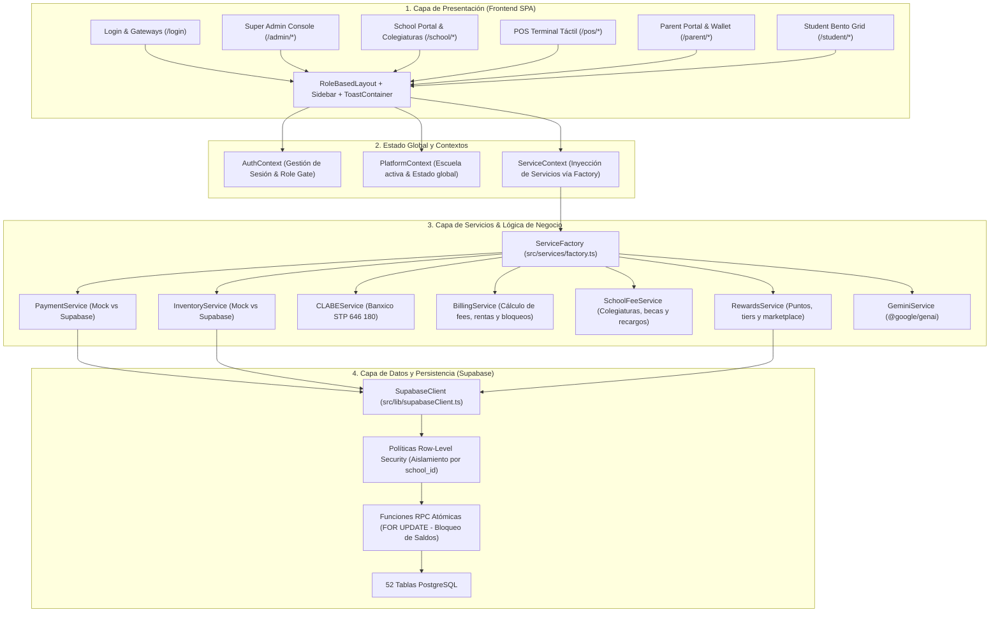
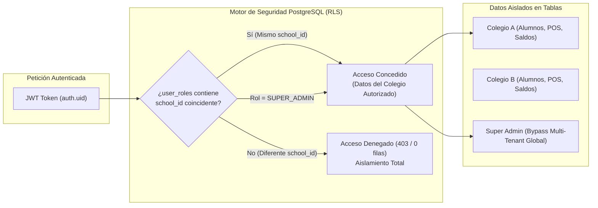
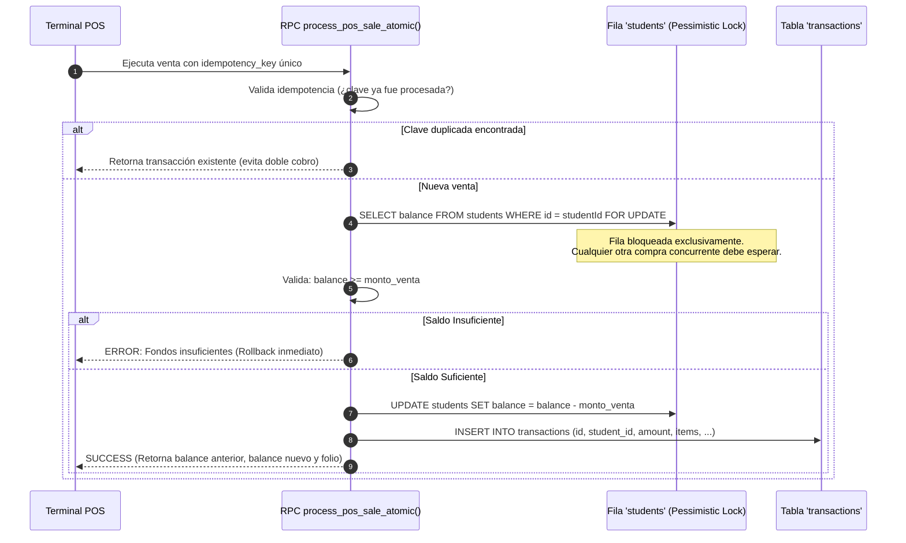
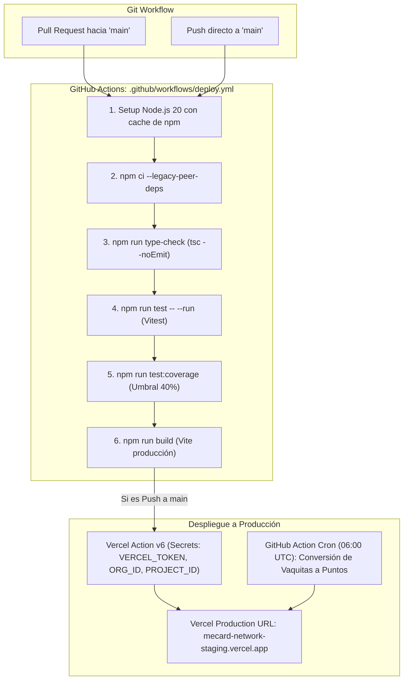

# 04. Arquitectura Técnica y de Datos de MeCard

> **Fuentes de Evidencia:** [package.json](file:///c:/Users/Usuario1/FRCB/Mecard-main-clean/package.json), [vite.config.ts](file:///c:/Users/Usuario1/FRCB/Mecard-main-clean/vite.config.ts), [tsconfig.json](file:///c:/Users/Usuario1/FRCB/Mecard-main-clean/tsconfig.json), [SUPABASE_SCHEMA.sql](file:///c:/Users/Usuario1/FRCB/Mecard-main-clean/SUPABASE_SCHEMA.sql), [SECURITY_FIXES_PHASE1.sql](file:///c:/Users/Usuario1/FRCB/Mecard-main-clean/SECURITY_FIXES_PHASE1.sql) y [src/services/factory.ts](file:///c:/Users/Usuario1/FRCB/Mecard-main-clean/src/services/factory.ts).

---

## 1. Stack Tecnológico y Dependencias

```
┌────────────────────────────────────────────────────────────────────────┐
│                        STACK TECNOLÓGICO MECARD                        │
├────────────────────┬────────────────────┬──────────────────────────────┤
│ CAPA               │ TECNOLOGÍA         │ VERSIÓN EXACTA EN REPOSITORIO│
├────────────────────┼────────────────────┼──────────────────────────────┤
│ Entorno / Runtime  │ Node.js            │ 20.x (definido en package/nvm)│
│ Gestor de Paquetes │ npm                │ >=10 <12                     │
│ Bundler / Build    │ Vite               │ ^6.0.11                      │
│ Lenguaje           │ TypeScript         │ ^5.7.3 (Strict Mode)         │
│ Core UI            │ React              │ ^19.0.0                      │
│ Router             │ React Router DOM   │ ^7.13.0                      │
│ Estilos / CSS      │ Tailwind CSS       │ ^3.4.17 + PostCSS ^8.5.1     │
│ Componentes Visual │ Lucide React       │ ^0.474.0                     │
│ Gráficas / Charts  │ Recharts           │ ^2.15.1                      │
│ QR Code Generator  │ qrcode.react       │ ^4.2.0                       │
│ CSV Parser         │ PapaParse          │ ^5.5.2                       │
│ Base de Datos / BaaS│ Supabase JS        │ ^2.48.2                      │
│ Inteligencia Art.  │ Google GenAI SDK   │ ^1.3.0                       │
│ Unit Testing       │ Vitest             │ ^1.0.4 + jsdom ^23.0.1       │
│ Testing Library    │ Testing Library    │ React ^14.1.2, DOM ^6.1.5    │
│ Hosting Frontend   │ Vercel             │ Node 20 Production Edge      │
└────────────────────┴────────────────────┴──────────────────────────────┘
```

---

## 2. Diagrama de Arquitectura por Capas



---

## 3. Modelo de Aislamiento Multi-Tenant (Seguridad Escolar)

La plataforma está diseñada con una arquitectura **Single-Database, Multi-Tenant con Partición Lógica** mediante la columna `school_id` y políticas estrictas de **Row-Level Security (RLS)** en PostgreSQL:



### Reglas RLS Implementadas en [SECURITY_FIXES_PHASE1.sql](file:///c:/Users/Usuario1/FRCB/Mecard-main-clean/SECURITY_FIXES_PHASE1.sql):
- **Cláusulas `WITH CHECK`:** Todas las operaciones `INSERT` y `UPDATE` exigen la cláusula `WITH CHECK` para impedir que un usuario inyecte registros pertenecientes a otra institución educativa.
- **Validación no nula de `school_id`:** Ninguna transacción o saldo puede tener `school_id IS NULL`, evitando registros huérfanos o con fuga global de visibilidad.
- **Jerarquía Familiar:** Un padre (`PARENT`) únicamente puede leer registros en `students`, `wallet_transactions` y `exit_permissions` si existe una relación activa en la tabla de unión `parent_student_links` donde `parent_id = auth.uid()`.

---

## 4. Concurrencia y Transacciones Financieras Atómicas

Uno de los mayores logros técnicos del proyecto fue la erradicación del riesgo de **doble gasto (*double-spending*)** en el POS mediante transacciones atómicas con bloqueo pesimista a nivel de fila (`SELECT ... FOR UPDATE`):



---

## 5. Pipeline de CI/CD e Infraestructura de Despliegues

El despliegue está automatizado mediante **GitHub Actions** conectado a **Vercel** y **Supabase**:



### Factores Críticos de Infraestructura
1. **Node 20 Lock:** Alineación estricta de versión en [package.json:L6-L9](file:///c:/Users/Usuario1/FRCB/Mecard-main-clean/package.json#L6-L9) (`"engines": { "node": "20.x" }`), [.nvmrc](file:///c:/Users/Usuario1/FRCB/Mecard-main-clean/.nvmrc) y workflows de GitHub.
2. **Dependabot Groups:** Configurado en [.github/dependabot.yml](file:///c:/Users/Usuario1/FRCB/Mecard-main-clean/.github/dependabot.yml) para agrupar actualizaciones acopladas de React y librerías de prueba, ignorando *major updates* arriesgadas de Tailwind y Node types.
3. **Manejo de Peer Dependencies:** Inclusión sistemática de `--legacy-peer-deps` en los comandos de instalación de Vercel y CI para resolver diferencias entre React 19 y librerías periféricas.
