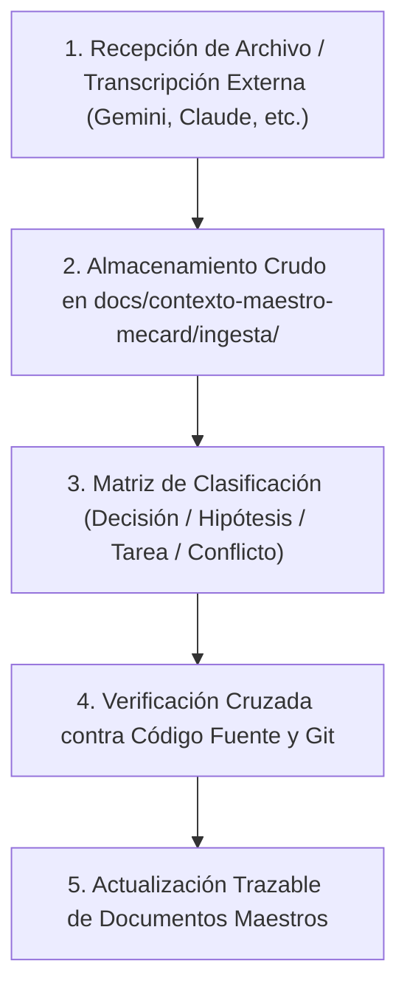

# 13. Protocolo de Ingesta y Trazabilidad para Nuevas Conversaciones de IA

> **Propósito:** Establecer un procedimiento estricto, auditable y libre de ambigüedades para incorporar gradualmente resúmenes, bitácoras o exportaciones de conversaciones sostenidas previamente con **Gemini, Claude, ChatGPT u otros agentes**, actualizando los documentos maestros de MeCard sin perder la trazabilidad de fuentes ni generar contradicciones en el código.

---

## 1. El Reto de la Información Fragmentada en IAs

Durante el ciclo de vida de un producto digital, los fundadores suelen debatir ideas, cambios de alcance y decisiones arquitectónicas con diversos modelos de IA (Claude para arquitectura y código, Gemini para estrategia y brainstorming, ChatGPT para producto y marketing).

Si estas conversaciones se incorporan sin un protocolo metódico, se generan tres graves patologías:
1. **Contaminación de "Ideas" como "Código Real":** Tomar una sugerencia teórica de un modelo como si ya estuviera programada en el repositorio.
2. **Contradicciones de Stack y Alcance:** Como ocurrió con el documento residual del proyecto PETER (Next.js 14 frente al React 19 real de MeCard).
3. **Pérdida de Trazabilidad:** Incapacidad de saber qué versión de la decisión es la vigente y quién la autorizó.

---

## 2. Flujo de Ingesta en 5 Pasos



### Paso 1: Recepción y Almacenamiento Crudo (*Intake*)
- Cuando el propietario disponga de transcripciones, notas o resúmenes de Gemini o Claude, estos se guardarán en texto plano o Markdown dentro del subdirectorio:  
  `docs/contexto-maestro-mecard/ingesta/`
- Nomenclatura obligatoria:  
  `YYYY-MM-DD_ORIGEN_TEMA.md` (ej. `2026-04-10_CLAUDE_arquitectura_reembolsos.md` o `2026-03-15_GEMINI_estrategia_colegios.md`).

### Paso 2: Extracción y Clasificación Semántica Obligatoria
Todo contenido extraído de la conversación debe someterse a esta clasificación antes de ser trasladado a los documentos maestros:

| Categoría | Criterio de Inclusión | Destino en Documentos Maestros |
|---|---|---|
| **Decisión Aprobada** | El fundador dice explícitamente *"apruebo"*, *"así lo haremos"* o *"queda cerrado"*. | [08_DECISIONES_Y_CONTRADICCIONES.md](file:///c:/Users/Usuario1/FRCB/Mecard-main-clean/docs/contexto-maestro-mecard/08_DECISIONES_Y_CONTRADICCIONES.md) |
| **Hipótesis Comercial** | Ideas de negocio no cerradas con clientes o proveedores (ej. sharing de comisiones). | [01_VISION_Y_MODELO_NEGOCIO.md](file:///c:/Users/Usuario1/FRCB/Mecard-main-clean/docs/contexto-maestro-mecard/01_VISION_Y_MODELO_NEGOCIO.md) |
| **Requisito Funcional** | Nuevas pantallas, flujos o campos de formulario requeridos. | [02_MAPA_FUNCIONAL.md](file:///c:/Users/Usuario1/FRCB/Mecard-main-clean/docs/contexto-maestro-mecard/02_MAPA_FUNCIONAL.md) y [03_MATRIZ_FUNCIONALIDADES.md](file:///c:/Users/Usuario1/FRCB/Mecard-main-clean/docs/contexto-maestro-mecard/03_MATRIZ_FUNCIONALIDADES.md) |
| **Nueva Tarea / Bug** | Fallo detectado o deuda técnica acordada para resolver. | [09_BACKLOG_CONSOLIDADO.md](file:///c:/Users/Usuario1/FRCB/Mecard-main-clean/docs/contexto-maestro-mecard/09_BACKLOG_CONSOLIDADO.md) (según prioridad P0-P3) |
| **Conflicto / Contradicción** | Una instrucción que contradice el código existente o una decisión previa. | Sección 2 de [08_DECISIONES_Y_CONTRADICCIONES.md](file:///c:/Users/Usuario1/FRCB/Mecard-main-clean/docs/contexto-maestro-mecard/08_DECISIONES_Y_CONTRADICCIONES.md) |

### Paso 3: Verificación Empírica contra el Código Fuente
Antes de actualizar un documento afirmando que una tarea está terminada:
1. Buscar en el código con `grep_search` o `run_command` si las clases, funciones o tablas mencionadas en la conversación realmente existen en el repositorio.
2. Si la conversación afirma que algo está terminado pero en el código no existe o está en mock, registrar como **"Diseñado / Parcial"** y registrar la discrepancia en [08_DECISIONES_Y_CONTRADICCIONES.md](file:///c:/Users/Usuario1/FRCB/Mecard-main-clean/docs/contexto-maestro-mecard/08_DECISIONES_Y_CONTRADICCIONES.md).

### Paso 4: Formato Estándar de Ficha de Trazabilidad
Cada actualización en los documentos maestros debe incluir un pie de cita con este formato:

```markdown
> 📌 **Fuente:** Conversación Claude del 2026-03-15 (`docs/contexto-maestro-mecard/ingesta/2026-03-15_CLAUDE.md`)
> - **Cita original:** *"El co-padre no debe tener jerarquía menor, ambos padres deben ser iguales."*
> - **Impacto:** Modificación a la tabla parent_student_links y creación de activity_log.
> - **Estado en código:** Implementado en ParentSettingsView.tsx (commit 6b03d0b).
```

### Paso 5: Sincronización con el Documento de GPT-6
Una vez actualizados los documentos maestros detallados:
1. Extraer los 3 o 4 puntos más trascendentes.
2. Actualizar la sección correspondiente en [12_CONTEXTO_PARA_GPT6.md](file:///c:/Users/Usuario1/FRCB/Mecard-main-clean/docs/contexto-maestro-mecard/12_CONTEXTO_PARA_GPT6.md).
3. Notificar al propietario para que GPT-6 mantenga siempre la versión canónica más fresca del proyecto.

---

## 3. Ejemplo Práctico de Aplicación del Protocolo

**Escenario Hipotético:** El propietario entrega un archivo exportado de Gemini con una discusión sobre cómo manejar los uniformes escolares en la tienda.
1. Se guarda en `docs/contexto-maestro-mecard/ingesta/2026-04-12_GEMINI_uniformes.md`.
2. Se analiza: ¿Hubo decisión de incluir uniformes en el MVP?
   - Si el propietario dijo *"me gusta la idea pero dejémoslo para después del piloto"*, se clasifica como **P3 (Futuro)** en [09_BACKLOG_CONSOLIDADO.md](file:///c:/Users/Usuario1/FRCB/Mecard-main-clean/docs/contexto-maestro-mecard/09_BACKLOG_CONSOLIDADO.md).
   - No se crea código nuevo en `src/components/`.
   - No se altera la fecha del go-live de Fase 1.
   - Se mantiene la estabilidad del proyecto.
